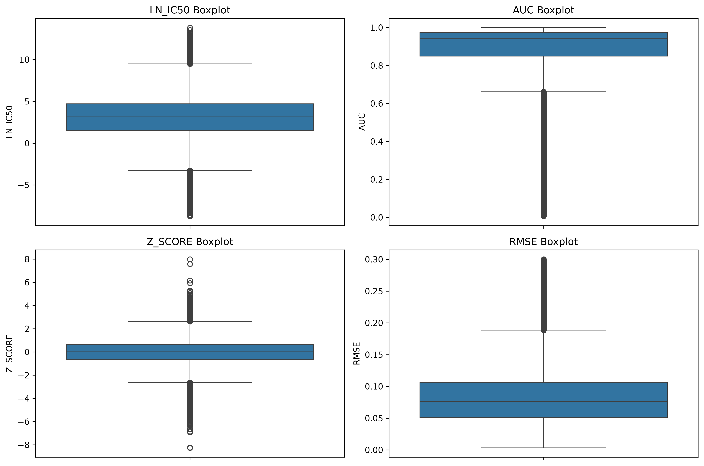
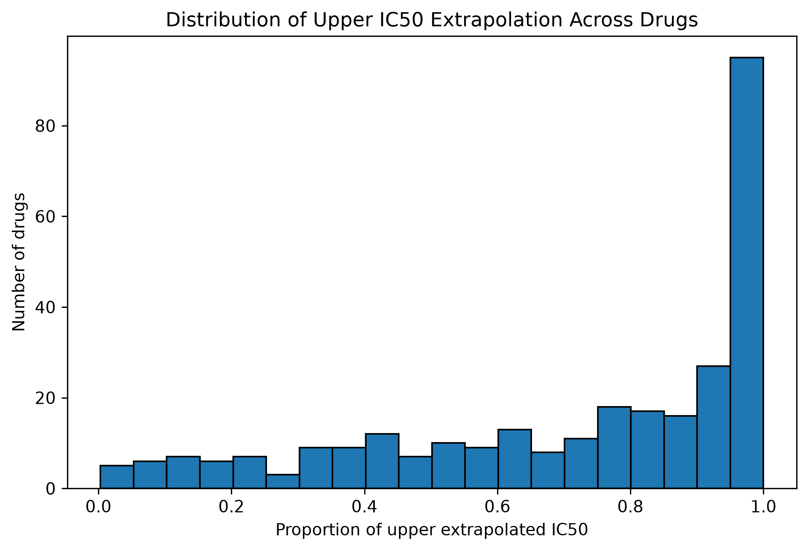
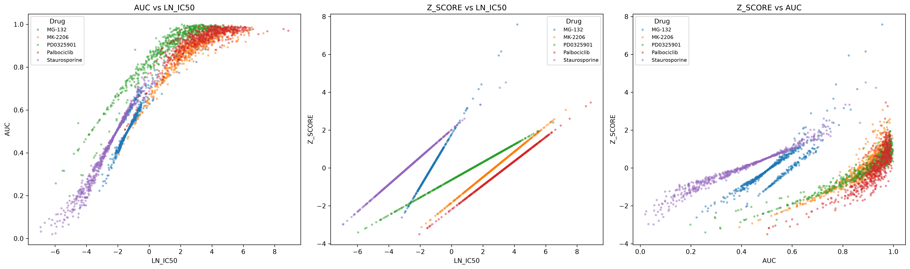
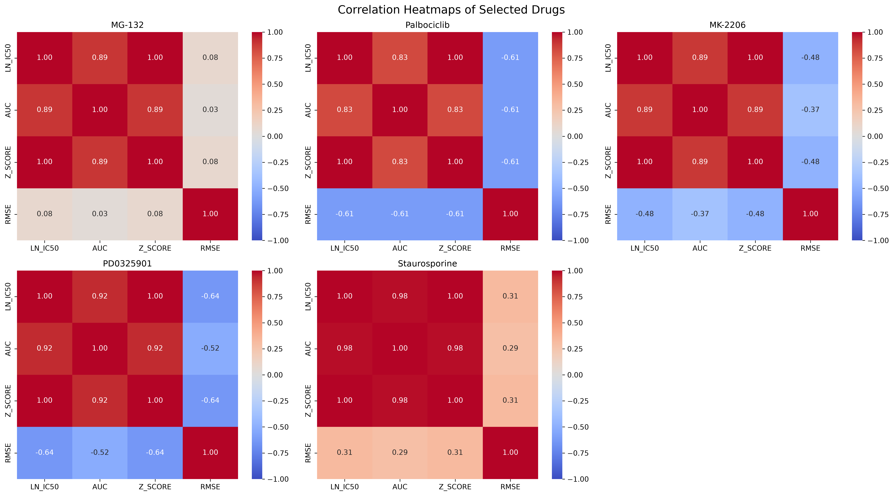
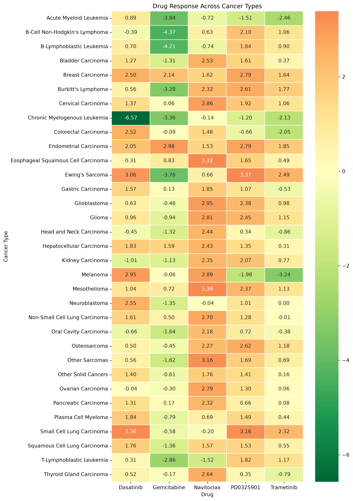

# GDSC2 Drug Response – Exploratory Data Analysis

An exploratory analysis of the GDSC2 fitted dose-response dataset (242,036 cell line–drug measurements), focused on three questions: **how reliable are the response metrics, how do they relate to each other, and how does in-vitro drug sensitivity differ across cancer types?**

> All findings describe **relative drug sensitivity in cancer cell-line models**. They are not statements about clinical effectiveness or patient outcomes.

---

## 1. Project Overview

The Genomics of Drug Sensitivity in Cancer (GDSC) project screens cancer cell lines against a large panel of compounds and fits a dose-response curve to each cell line–drug pair. This project does not model the data; it examines it critically before anyone relies on it:

- Is the dataset structurally sound, and where is it uneven?
- How do the four response metrics (`LN_IC50`, `AUC`, `Z_SCORE`, `RMSE`) behave, and how much can each one be trusted?
- What does the data say about differences in drug response across cancer types, using five selected drugs as a case study?

The full analysis is in [`drug_response.ipynb`](drug_response.ipynb). This README summarises what it found and why it matters.

## 2. Research Questions

1. **Data quality:** Are there missing values, duplicates, or identifier problems that would distort drug-level analysis?
2. **Metric behaviour:** What are the distributions of `LN_IC50`, `AUC`, `Z_SCORE` and `RMSE`, and are extreme values errors or biology?
3. **IC50 reliability:** How often does the fitted IC50 fall outside the concentration range that was actually tested?
4. **Metric relationships:** How strongly do `LN_IC50`, `AUC`, `Z_SCORE` and `RMSE` relate to each other, and is that consistent across individual drugs?
5. **Cancer-type differences:** For five drugs with broad coverage and heterogeneous response (Navitoclax, PD0325901, Trametinib, Gemcitabine, Dasatinib), which cancer types look relatively sensitive or resistant in vitro?

## 3. Dataset

| Property | Value |
|---|---|
| File | `GDSC2_fitted_dose_response_27Oct23.xlsx` |
| Rows × columns | 242,036 × 16 |
| Cell line models | 969 |
| Cancer types | 42 |
| Drug screens (`DRUG_ID`) | 295 (286 unique drug names) |

Key variables: `LN_IC50` (natural log of the fitted IC50), `AUC` (area under the dose-response curve), `Z_SCORE` (LN_IC50 standardised within each drug), `RMSE` (curve-fit error), plus `MIN_CONC` / `MAX_CONC` (tested concentration range), `CANCER_TYPE`, `DRUG_NAME`, `DRUG_ID`, `PUTATIVE_TARGET` and `PATHWAY_NAME`.

**Reading the metrics:** lower `LN_IC50` and lower `AUC` indicate greater in-vitro sensitivity. `Z_SCORE` expresses how a cell line responds relative to other cell lines tested with the *same* drug. `RMSE` describes curve-fitting quality, not sensitivity.

**The original Excel file is not included in this repository.** To reproduce the analysis, obtain the file from the GDSC project and place it in the project folder. The notebook reads a CSV copy (`GDSC2_fitted_dose_response_27Oct23.csv`); the one-time Excel-to-CSV conversion is included in the notebook as commented-out code.

## 4. Tools and Libraries

- **Python** in a **Jupyter Notebook**
- **pandas**, **NumPy** – data handling and summaries
- **Matplotlib**, **seaborn** – visualisation
- **SciPy** (`pearsonr`, `spearmanr`) – correlation analysis

## 5. Data Quality Assessment

| Check | Result |
|---|---|
| Missing values | Only `PUTATIVE_TARGET` is affected: 27,155 rows (11.22%) |
| Exact duplicate rows | 0 |
| Duplicate (cell line, `DRUG_ID`) pairs | 0 |
| Cell line name ↔ Sanger model ID | One-to-one |
| Impossible concentrations (`MIN_CONC` > `MAX_CONC`) | None |
| Drug names with two `DRUG_ID`s | 9 drugs (Acetalax, Dactinomycin, Docetaxel, Fulvestrant, GSK343, Oxaliplatin, Selumetinib, Ulixertinib, Uprosertib) |

Two structural issues shaped the rest of the analysis:

- **Duplicate drug names are not duplicates.** For the nine drugs above, the two `DRUG_ID`s differ in tested concentration range and/or number of cell lines. Grouping by name would create 6,288 repeated (cell line, drug name) pairs and mix different screens, so **`DRUG_ID` is used as the drug key** for drug-level analysis. For example, Docetaxel looks like it was tested on 968 cell lines by name, but its two screens covered 967 (ID 1007) and 670 (ID 1819).
- **The cell line × drug matrix is incomplete.** Cell lines were tested in between 12 and 295 screens, and the number of cell lines per drug screen ranges from 225 to 969 (median 893). Cancer-type coverage is also uneven, from 88 models for Non-Small Cell Lung Carcinoma down to 4 for Biliary Tract Carcinoma.

## 6. Analytical Approach

1. **Audit** the dataset (missing values, duplicates, identifier mapping, concentration sanity checks, drug and cancer-type coverage).
2. **Profile** the four response metrics: descriptive statistics, histograms, and IQR-based outlier detection. Outliers were inspected, not removed.
3. **Test IC50 extrapolation** by converting `LN_IC50` back to IC50 (`exp`) and comparing it with each row's `MIN_CONC` and `MAX_CONC`.
4. **Quantify relationships** between metrics with Pearson and Spearman correlations, pooled across all data and within five high-coverage drugs (MG-132, Palbociclib, MK-2206, PD0325901, Staurosporine).
5. **Compare cancer types** for five drugs chosen by combining their rank in cell-line coverage with their rank in `LN_IC50` standard deviation. Only cancer type–drug groups with at least 10 cell lines were kept (165 of 210 groups, 33 cancer types).

## 7. Key Findings

### 7.1 Most fitted IC50 values lie beyond the tested concentration range

Converting `LN_IC50` back to IC50 and comparing it with the tested range shows a strong asymmetry:

- **71.81%** of all measurements (173,805 rows) have an estimated IC50 **above** `MAX_CONC`, meaning 50% inhibition was not reached within the tested range.
- Only **0.31%** (740 rows) fall **below** `MIN_CONC`.
- At the drug level the pattern is widespread but uneven: the mean proportion is about 72%, the median about 84%, and it ranges from 0.3% to 100%. At least ten screens (for example VTP-B, SL0101, GSK343 and Cyclophosphamide) have 100% of their IC50 values above the maximum tested concentration.

**Why it matters:** for the large resistant majority, `LN_IC50` is a model extrapolation rather than a measured potency. This is the most important caveat for interpreting any IC50-based ranking in this dataset.

### 7.2 The four metrics have very different shapes, and extreme values are mostly signal

- `LN_IC50` has a mean (2.82) below its median (3.24) and `AUC` has a mean (0.883) below its median (0.944), i.e. both are negatively skewed. `RMSE` has the opposite pattern (mean 0.083, median 0.076). `Z_SCORE` is centred on zero with a standard deviation of about 1.
- The IQR rule flags 4.77% of `LN_IC50` values (11,543 rows), **88% of them on the low, sensitive side** (10,138 low vs 1,405 high), as well as 8.29% of `AUC`, 1.24% of `Z_SCORE` and 2.25% of `RMSE` values.
- Inspecting the most extreme rows showed that very low `LN_IC50` and very low `AUC` occur together, which is consistent with strong in-vitro sensitivity rather than data errors. They were therefore retained.
- `RMSE` never exceeds about 0.30. This matches the GDSC documentation that curves with `RMSE` above 0.3 were excluded before release, so the dataset's worst fits were already filtered out.

### 7.3 LN_IC50 and AUC agree, but pooled correlations hide drug-specific behaviour

| Pair | Pooled (all rows) | Within five high-coverage drugs |
|---|---|---|
| `LN_IC50` – `AUC` | Pearson 0.76, Spearman 0.76 | Pearson 0.83–0.98, Spearman 0.82–0.995 |
| `LN_IC50` – `Z_SCORE` | Pearson 0.51, Spearman 0.57 | exactly 1.00 |
| `AUC` – `Z_SCORE` | Pearson 0.44, Spearman 0.45 | same as `LN_IC50` – `AUC` (0.83–0.98) |
| `LN_IC50` – `RMSE` | Pearson −0.43 | **−0.64 to +0.31, depending on the drug** |

- The correlation within each drug is higher than the pooled value for all five drugs examined. The scatter plots show why: each drug traces its own curve, so pooling them blurs the relationship.
- `Z_SCORE` is a within-drug standardisation of `LN_IC50`, so its correlation with `LN_IC50` is exactly 1 inside a drug (an expected consequence of how it is built, not a finding). It should **not** be used to compare absolute sensitivity *between* drugs.
- The pooled `RMSE` correlation is moderate and negative, but at the drug level it ranges from clearly negative (PD0325901, −0.64) to slightly positive (Staurosporine, +0.31) and near zero (MG-132, 0.08). The pooled number should not be generalised to individual drugs.

These are correlations between two metrics derived from the same dose-response curve. They say the metrics agree, not that one drives the other.

### 7.4 Drug response differs strongly by cancer type, and in a compound-specific way

The five drugs were selected for broad coverage (960–968 cell lines each, spanning all 42 cancer types) and heterogeneous response. Their overall `LN_IC50` profiles differ:

| Drug (`DRUG_ID`) | Cell lines | Median `LN_IC50` | SD of `LN_IC50` |
|---|---|---|---|
| Navitoclax (1011) | 967 | 2.10 | 2.00 |
| PD0325901 (1060) | 968 | 1.68 | 2.14 |
| Dasatinib (1079) | 962 | 1.55 | 2.32 |
| Trametinib (1372) | 966 | 0.54 | 2.26 |
| Gemcitabine (1190) | 960 | −1.06 | 3.01 |

Mean `LN_IC50` by cancer type (groups with ≥10 cell lines; *n* = cell lines in the group):

- **Gemcitabine:** lowest in B-Cell Non-Hodgkin's Lymphoma (−4.37, *n* = 37), B-Lymphoblastic Leukemia (−4.21, *n* = 20), Acute Myeloid Leukemia (−3.84, *n* = 28) and Ewing's Sarcoma (−3.76, *n* = 22); highest in Endometrial Carcinoma (2.98, *n* = 10) and Breast Carcinoma (2.14, *n* = 51).
- **PD0325901 and Trametinib** show a similar pattern: both are lowest in Melanoma (−1.98 and −3.24, *n* = 54) and high in Ewing's Sarcoma (3.37 and 2.49) and Small Cell Lung Carcinoma (3.16 and 2.32). Both are MEK-pathway inhibitors, which may explain the resemblance, but the notebook does not test this.
- **Navitoclax** behaves differently: lowest in T-Lymphoblastic Leukemia (−1.52, *n* = 18), B-Lymphoblastic Leukemia (−0.74) and Acute Myeloid Leukemia (−0.72); highest in Mesothelioma (3.39, *n* = 21), Esophageal Squamous Cell Carcinoma (3.32, *n* = 26) and Other Sarcomas (3.16, *n* = 15).
- **Dasatinib:** the single most extreme cell in the analysis is Chronic Myelogenous Leukemia (−6.57), but this group has only **10 cell lines**. The highest value is in Small Cell Lung Carcinoma (3.36, *n* = 58).

Cross-drug patterns:

- **Sensitivity is compound-specific, not a property of the cancer type alone.** Melanoma is the most sensitive group for the two MEK-pathway inhibitors, yet it is among the more resistant groups for Dasatinib (2.95) and Navitoclax (2.89). Ewing's Sarcoma is among the most sensitive groups for Gemcitabine but among the most resistant for PD0325901, Trametinib and Dasatinib.
- **Haematological cancer types** (especially Acute Myeloid Leukemia) tend to sit on the sensitive side for four of the five drugs, the exception being Dasatinib (0.89).
- **Breast Carcinoma** has comparatively high mean `LN_IC50` for all five drugs (1.62–2.79).

## 8. Selected Visualizations

Five of the eleven exported figures are shown, chosen because each adds a distinct insight. Reasons for the omitted figures are given in the notes at the end of this section.

### 8.1 Four metrics, four different shapes



This single figure shows why the four metrics cannot be treated alike. `LN_IC50` has a wide interquartile range with long tails, heavier on the low (sensitive) side. `AUC` is compressed against its upper limit of 1, with a dense run of low values below the box. `Z_SCORE` is symmetric around zero. `RMSE` has a long upper tail that stops abruptly near 0.30, the GDSC quality cut-off.

**Takeaway:** the many points flagged as "outliers" mainly describe a population of strongly responding cell line–drug pairs, not measurement errors, so they were kept. The `RMSE` ceiling is a visible trace of the dataset's own quality filtering.

### 8.2 Most drug screens are dominated by extrapolated IC50 values



Each observation counted here is a fitted IC50 above the highest concentration tested. The distribution is strongly weighted toward 100%: the tallest bar is at the far right, while the remaining screens spread across lower proportions.

**Takeaway:** the 71.81% figure is not driven by a handful of unusual compounds. For most drug screens, the majority of fitted IC50 values are not directly supported by measurements within the tested range, which limits how precisely resistant responses can be ranked using `LN_IC50`.

### 8.3 Pooled correlations mix drug-specific curves



*600 randomly sampled points per drug (`random_state=42`).* In the left panel, each drug follows its own curve, and `AUC` flattens out near 1 once `LN_IC50` becomes large. In the middle panel, `Z_SCORE` is a perfectly straight line against `LN_IC50` for each drug, but the lines have different slopes and offsets. In the right panel, the same drug-specific structure appears as curves.

**Takeaway:** the pooled correlation of 0.76 between `LN_IC50` and `AUC` summarises a family of drug-specific relationships. The flattening of `AUC` near 1 also suggests that `AUC` distinguishes little between weakly responding cell lines that still differ in `LN_IC50`. And because `Z_SCORE` is rescaled per drug, equal `Z_SCORE` values for two different drugs do not mean equal potency.

### 8.4 Fit quality relates to response differently for each drug



`LN_IC50`–`AUC` is strongly positive for every drug (0.83–0.98), and `LN_IC50`–`Z_SCORE` is 1.00 by construction. The `RMSE` row is where the drugs diverge: negative for Palbociclib (−0.61), MK-2206 (−0.48) and PD0325901 (−0.64), positive for Staurosporine (+0.31), and close to zero for MG-132 (0.08).

**Takeaway:** the whole-dataset heatmap's negative `RMSE` correlations (−0.43 with `LN_IC50`) are an average over very different drug-level behaviours. Curve-fit error cannot be assumed to track sensitivity in the same way for every compound. The five drugs here were selected for high coverage, so they illustrate the inconsistency rather than estimate how common each pattern is.

### 8.5 Drug response varies across cancer types, and differently for each drug



Each cell is the mean `LN_IC50` of one cancer type for one drug (green = lower = relatively more sensitive; orange = higher = relatively less sensitive). Only groups with at least 10 cell lines are shown. The strongest structure is in individual columns: Gemcitabine's green band across haematological types and Ewing's Sarcoma, the PD0325901 and Trametinib co-sensitivity in Melanoma, Navitoclax's high values in several solid tumours, and the Dasatinib cell for Chronic Myelogenous Leukemia (−6.57, *n* = 10).

**Takeaway:** response is jointly determined by drug and cancer type, so no cancer type is simply "sensitive" or "resistant". Compare values within a column, not across columns: the drugs were tested over different concentration ranges and, as shown in 7.1, many high `LN_IC50` values are extrapolated, so absolute differences between drugs are not directly comparable.

> **Notes on figures not shown.** `distributions.png` is not used because the exported file contains only the `Z_SCORE` histogram; the distribution shapes of all four metrics are shown more completely in 8.1. `IC50vsAUC_scatterplot.png` is heavily overplotted and is superseded by the drug-resolved view in 8.3. `heatmapcorr_drugresponse.png` contains only four numbers that are reported in the text in 7.3. `selecteddrugs_correlation.png` repeats the information in 8.3. `selectedrugs_IC50distributions.png` is summarised by the table in 7.4. `drugvscelline.png` is a coverage bar chart whose information is stated in Section 5.

## 9. Limitations

- **In vitro, not clinical.** Cell-line responses do not establish how a drug performs in patients. "Sensitive" and "resistant" here mean relative `LN_IC50` within this dataset.
- **Uneven coverage.** Cancer types range from 4 to 88 cell line models, and not every cell line was tested with every drug.
- **Small groups.** Even after requiring at least 10 cell lines, several cancer-type groups are small. Extreme values, such as Dasatinib in Chronic Myelogenous Leukemia (*n* = 10), may not be stable. The 45 of 210 drug–cancer type groups with fewer than 10 cell lines were excluded from the comparison.
- **Extrapolated IC50 values.** 71.81% of fitted IC50 values exceed the maximum tested concentration. The extrapolation rate was not calculated per cancer type or for the five selected drugs, so the reliability of individual cancer-type means is untested.
- **Descriptive comparisons only.** Cancer-type rankings use mean `LN_IC50`; no significance tests, effect sizes or corrections for multiple comparisons were performed.
- **Correlation is not causation.** Metrics derived from the same curve are expected to agree, and the drug-level correlations come from five high-coverage drugs, not a random sample.
- **No molecular data.** The analysis cannot explain *why* cancer types differ; any biological explanation would require genomic or expression data.
- **Annotation gaps.** 11.22% of rows lack a putative target, and `Unclassified` is the most common pathway label (24,979 rows), which limits target- or pathway-level interpretation.

## 10. Conclusion

The GDSC2 dataset is structurally clean (no duplicate measurements, consistent identifiers, no impossible values) but must be handled with care. Drug names do not uniquely identify screens, coverage is uneven, and most fitted IC50 values lie beyond the tested concentration range. The response metrics agree with each other in broad terms, yet their relationships are drug-specific, so pooled correlations can mislead and `Z_SCORE` and `RMSE` need drug-aware interpretation. Across five well-covered drugs, in-vitro sensitivity varies widely between cancer types and in a compound-specific way, with several patterns worth follow-up (MEK-pathway inhibitors in Melanoma, Gemcitabine in haematological cancer types, Dasatinib in Chronic Myelogenous Leukemia).

The natural next step is to combine these response data with genomic or expression features and apply formal statistical testing, to move from describing differences in sensitivity to investigating their molecular basis.

---

## Repository Contents

```
├── README.md
├── drug_response.ipynb   # full analysis
└── images/               # exported figures (the five above are used in this README)
```

The GDSC2 Excel file (`GDSC2_fitted_dose_response_27Oct23.xlsx`) is not included.
